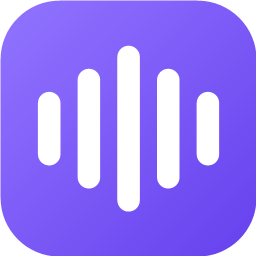
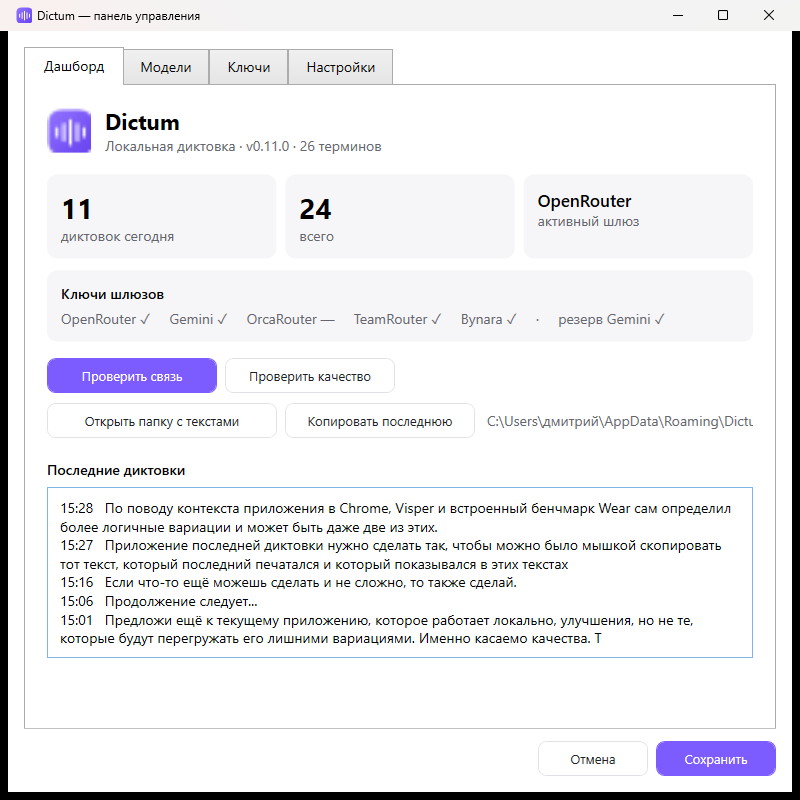
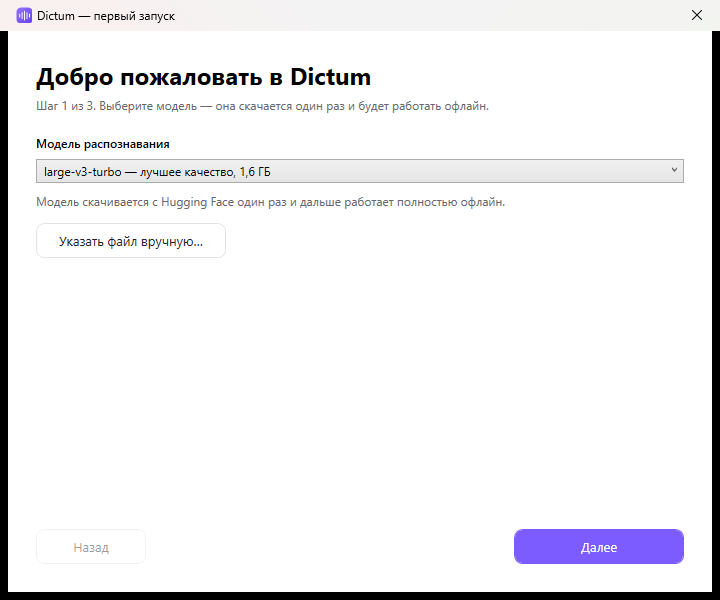
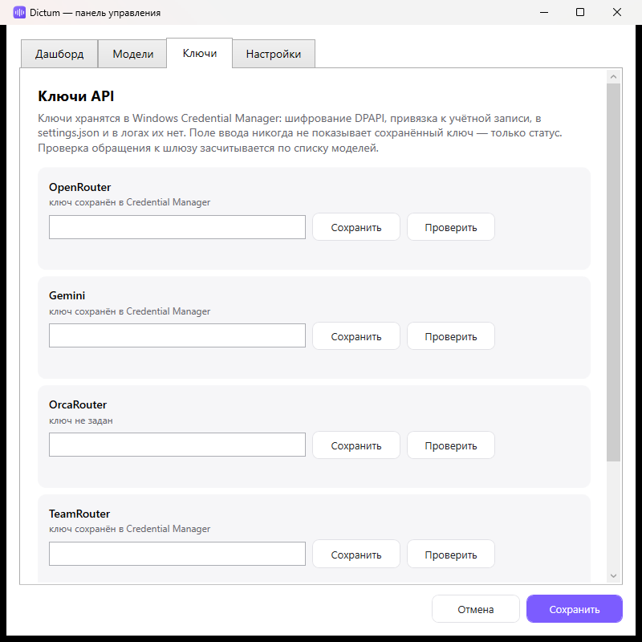
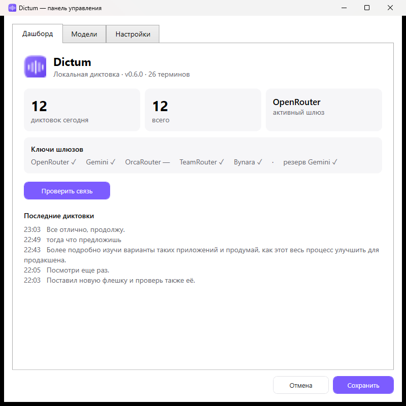
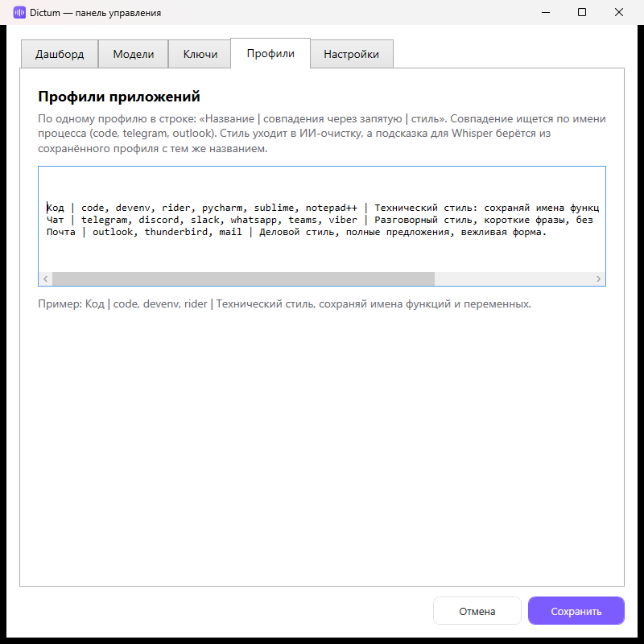

<p align="center">
  
</p>

<h1 align="center">Dictum</h1>

<p align="center">
  <b>Локальная диктовка для Windows.</b><br/>
  Whisper на вашей видеокарте, свой словарь IT-терминов, ноль облака по умолчанию.
</p>

<p align="center">
  <a href="https://github.com/ivanpetrv2026/dictum/releases/latest"></a>
  
  
  
</p>

<p align="center">
  
</p>

## Зачем

Удерживаешь **Ctrl+Win**, говоришь, отпускаешь — текст печатается в активное окно. Всё распознавание идёт на вашей машине: 14 секунд речи превращаются в текст примерно за секунду на RTX 3050.

| | Dictum | Облачные аналоги |
|---|---|---|
| Где обрабатывается звук | локально, на GPU | на сервере |
| Работа без интернета | да | нет |
| Свои термины и словарь | да, обучается на правках | ограниченно |
| Подписка | нет, MIT | $8–15 в месяц |
| Перехват клавиатуры | нет, опрос состояния клавиш | — |
| Доступ к буферу обмена | нет | — |

## Возможности

- **Распознавание на GPU.** whisper.cpp через Whisper.net, `large-v3-turbo`, CUDA 12. Если CUDA недоступна — автоматический откат на CPU.
- **Словарь терминов.** 72 записи из коробки: ClickHouse, PostgreSQL, Kubernetes, Jira, API, SQL, RDP и другие. Понимает падежи («графану» → Grafana) и опечатки («kubenetes» → Kubernetes).
- **Обучение.** Если поправить слово после вставки, пара «как распозналось → как исправлено» сохраняется как новый вариант.
- **Своя комбинация.** Ctrl+Win, Ctrl+Alt, Alt+Space, Ctrl+Shift+Space или F8.
- **VAD и нормализация громкости.** Тишина отбрасывается до распознавания, тихий микрофон усиливается до −3 dBFS. Поломанный вход — гул без речи (отошёл штекер, обрыв кабеля) — распознаётся по спектру и огибающей, пропускается и сопровождается уведомлением в трее.
- **Профили приложений.** Код, чат и почта получают разный стиль и разные подсказки для модели.
- **ИИ-очистка (опционально).** OpenRouter, OrcaRouter, TeamRouter, Bynara или свой OpenAI-совместимый endpoint; резервный Gemini. Выключена по умолчанию: текст уходит в сеть только после явного включения.
- **Локальный корректор.** Регистр, пробелы и голосовые знаки («запятая», «новая строка») работают офлайн, без ключей.
- **Архив и история.** Каждая фраза сохраняется в txt по дням; последние пять доступны на дашборде и копируются одним нажатием.
- **Бенчмарк качества.** Встроенный прогон восьми IT-фраз с подсчётом WER — чтобы сравнивать релизы цифрами.
- **Мастер первого запуска.** Модель, комбинация, проверка микрофона — три шага.
- **Менеджер моделей.** tiny…large, скачивание с прогрессом, удаление.
- **Индикатор записи.** Пульсирующая точка внизу экрана, не забирает фокус и не перехватывает клики.

## Установка

1. Скачайте последний релиз: <https://github.com/ivanpetrv2026/dictum/releases/latest>
2. Выберите вариант:

| Файл | Для чего |
|---|---|
| `Dictum_vX_x64_full_setup.exe` | установка с CUDA: распознавание на GPU |
| `Dictum_vX_x64_lite_setup.exe` | без CUDA: CPU, меньше размер |
| `Dictum_vX_portable.zip` | без установки: распаковать и запустить |

3. Запустите мастер: выберите модель (скачается один раз), комбинацию и проверьте микрофон.

Требования: Windows 10/11 x64. NVIDIA GPU желательна, но не обязательна. Установка идёт в профиль пользователя, без прав администратора.

## Как это работает

```
микрофон → VAD и обрезка тишины → нормализация громкости
        → Whisper (CUDA или CPU) → словарь терминов
        → ИИ-очистка (если включена) или локальный корректор
        → печать в активное окно + архив в txt
```

Ключевые технические решения:

- **Нет глобального хука клавиатуры.** Комбинация определяется опросом `GetAsyncKeyState` каждые 30 мс. `WH_KEYBOARD_LL` — то, что используют стилеры, и главный источник ложных срабатываний антивирусов.
- **Нет доступа к буферу обмена.** Текст вставляется через `SendInput` + `KEYEVENTF_UNICODE`; работает и в RDP, где клипборд отключён.
- **Нет фоновой сети.** Приложение не проверяет обновления и не собирает телеметрию. Единственный запрос — явно включённая ИИ-очистка, один HTTPS-вызов на диктовку.

## Приватность

- Ключи API хранятся в Windows Credential Manager (DPAPI), не в файлах и не в логах.
- Настройки, словарь и архив лежат в `%APPDATA%\Dictum` и никуда не отправляются.
- Аудио не покидает машину: Whisper работает локально.
- ИИ-очистка выключена по умолчанию; при включении отправляется только текст текущей диктовки.

Подробнее — в [SECURITY.md](SECURITY.md).

## Скриншоты

| Мастер первого запуска | Ключи API |
|---|---|
|  |  |

| Модели | Профили приложений |
|---|---|
|  |  |

## Сборка из исходников

Нужен .NET SDK 8.0.

```powershell
dotnet build src/Dictum/Dictum.csproj
dotnet publish src/Dictum/Dictum.csproj -c Release -r win-x64 --self-contained true -o publish
```

`PublishSingleFile` не используется: Whisper.net ищет нативную `whisper.dll` рядом с приложением.

CUDA-библиотеки (cuBLAS, cudart) в установщик не входят из-за размера — скрипт `tools/Get-CudaRuntime.ps1` скачивает их с официального редиста NVIDIA.

## Качество

Встроенный бенчмарк на синтезированных IT-фразах: **WER 11,7 %** (7 ошибок на 60 слов) на `large-v3-turbo`/CUDA. Запуск: кнопка «Проверить качество» на дашборде или `Dictum.exe --benchmark`.

Методика: 8 фиксированных IT-фраз (60 слов) озвучиваются системным TTS (System.Speech, установленный русский голос, 16 кГц mono) и прогоняются через тот же пайплайн, что и живая речь; WER считается по расстоянию Левенштейна на токенах после нормализации регистра. Синтезированный голос — не живая речь: цифра предназначена для сравнения релизов между собой, а не как абсолютная метрика качества.

Отдельные утилиты для проверки без микрофона:

```
Dictum.exe --vad-test file.wav     # границы речи и усиление
Dictum.exe --mic-diag              # микрофон: уровень, VAD, вердикт (настройки не меняет)
Dictum.exe --polish-test "текст"   # локальный корректор
Dictum.exe --ai-test               # проверка шлюза ИИ
```

## Ограничения

- Только Windows 10/11 x64.
- Whisper не потоковый: текст появляется после отпускания хоткея, а не по мере речи.
- Пунктуация без ИИ-ключа — правила, а не модель: сложные запятые может не расставить.
- Текущие релизы не подписаны кодовой подписью: подпись выполняется в CI (Azure Trusted Signing) и включится автоматически, когда в репозитории появятся секреты `AZURE_*`; до этого SmartScreen показывает «Unknown publisher». Проверка подлинности сборок — `SHA256SUMS.txt` и build-аттестации (см. [SECURITY.md](SECURITY.md)).

## Связаться и доработка под компанию

Нужны свои словари, интеграции, приватная сборка, подпись кода под вашим именем или доработка под задачу — пишите:

- **Telegram:** [@dmitriy198308](https://t.me/dmitriy198308) — самый быстрый способ;
- **Email:** [vsavsa67@gmail.com](mailto:vsavsa67@gmail.com).

Сообщения о багах и предложения — через [Issues](../../issues). Если пишете насчёт заказа, упомините, что пришли из этого README — так я вижу, что страница работает.

## Лицензия

MIT. См. [LICENSE](LICENSE).
